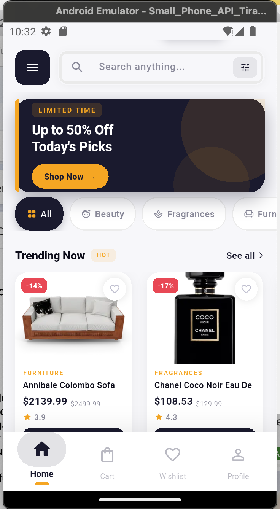
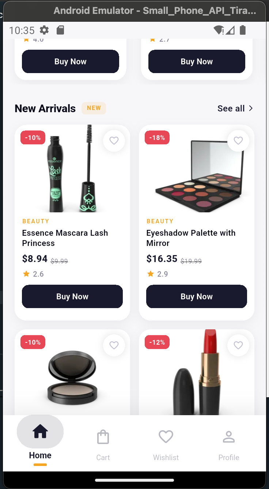
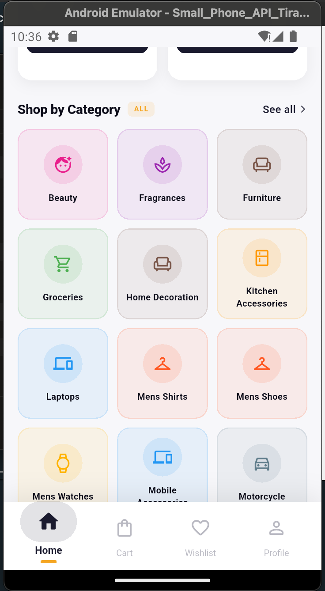
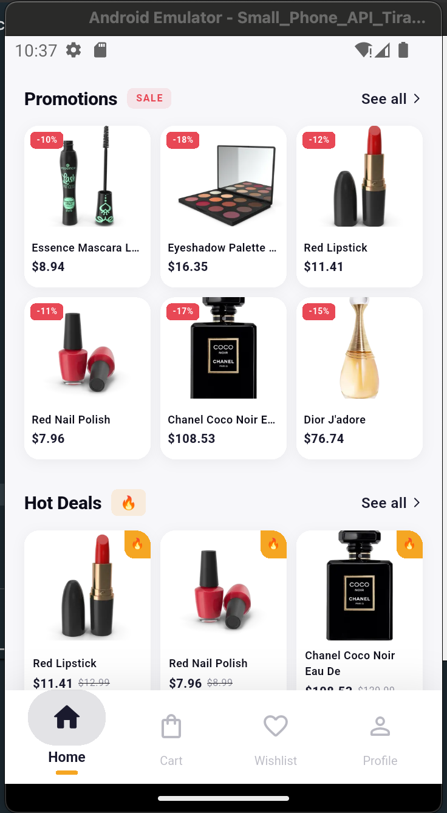
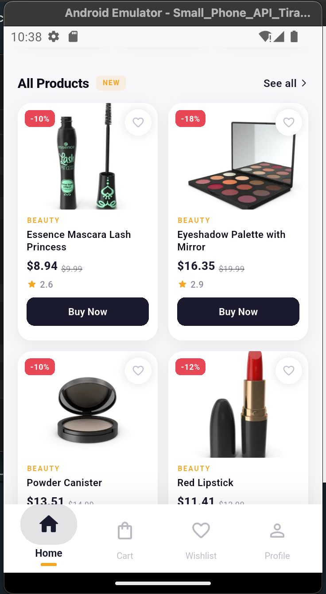
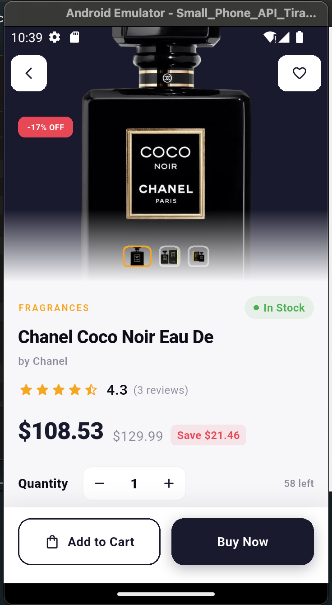
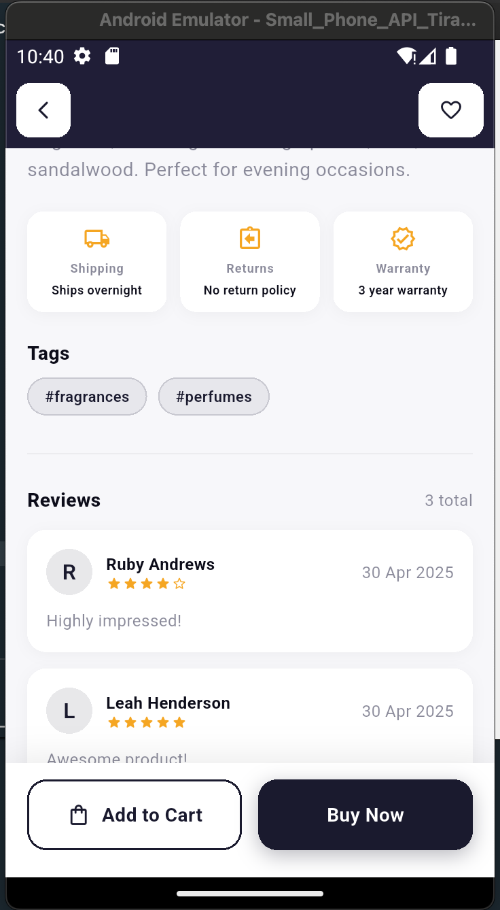
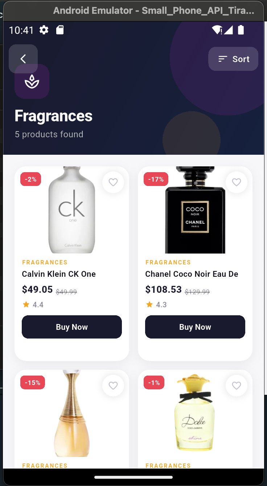

# LuxeCart — High Performance Product Feed

A high-performance Flutter e-commerce app. LuxeCart displays a rich product feed powered by the [DummyJSON API](https://dummyjson.com), featuring infinite scroll, category browsing, product details, and a local cart — all wrapped in a polished luxury UI.


## Screenshots

<table>
<tr><td align="center"><br>Home feed</td><td align="center"><br>New arrivals</td><td align="center"><br>Shop by category</td><td align="center"><br>Promotions and hot deals</td></tr>
<tr><td align="center"><br>All products</td><td align="center"><br>Product detail</td><td align="center"><br>Shipping, returns and reviews</td><td align="center"><br>Category listing</td></tr>
</table>

## Features

- **Infinite Scroll Feed** — Products load 10 at a time as you scroll, with a smooth loading indicator and an end-of-list message
- **Category Browsing** — Browse all categories in a visual grid, tap any to see its full product list with sort options
- **Product Details** — Full details screen with image gallery, ratings, reviews, shipping/warranty info, and quantity selector
- **Category Filtering** — Filter homepage sections by category
- **Beautiful UI** — Luxury navy + amber design system with smooth animations, custom bottom nav, and consistent typography

## Tech Stack

| Layer            | Technology                         |
| ---------------- | ---------------------------------- |
| Framework        | Flutter 3.x                        |
| State Management | Provider + MVVM                    |
| Navigation       | GoRouter                           |
| Networking       | Dio                                |
| Architecture     | MVVM (Model-View-ViewModel)        |
| API              | [DummyJSON](https://dummyjson.com) |

## Getting Started

### Prerequisites

Make sure you have the following installed:

- [Flutter SDK](https://docs.flutter.dev/get-started/install) **3.0.0 or higher**
- [Dart SDK](https://dart.dev/get-dart) **3.0.0 or higher**
- [Android Studio](https://developer.android.com/studio) or [VS Code](https://code.visualstudio.com/) with Flutter extension
- A connected device or emulator

## Architecture

LuxeCart follows the **MVVM (Model-View-ViewModel)** pattern:

```
View (Widgets)
    ↕  listens / calls
ViewModel (Provider + ChangeNotifier)
    ↕  calls
Service (Dio HTTP layer)
    ↕  fetches
API (DummyJSON)
```

- **Models** are plain Dart classes with `fromJson` factories
- **Services** handle all HTTP via a shared `dioRequestWrapper` in `BaseService`
- **ViewModels** extend `BaseViewModel`, manage state, and expose data to the UI
- **Views** consume ViewModels via `Consumer<T>` and `Provider.of<T>`

- ## Contact

Built by **Temitope Owolabi**
Email: temitope.owolabi@outlook.com
Phone: +234 8083231069
GitHub: [@haxzzallian](<[https://github.com/YOUR_USERNAME](https://github.com/haxzzallian)>)
